# Bridge agent manager UI

Create, run and supervise AI agents on your own machine, with every agent isolated in
its own sandbox. Think of it as Docker Desktop for agents: one place to see which agents
are running, what they are allowed to touch, what they did, and what went wrong.

> [!IMPORTANT]
> **This is a UI preview.** No runtime is connected yet. Agents, resource usage, the
> audit log and the shell are simulated in the window by a preview engine, and every
> screen shows a **Preview data** label. Nothing runs on your machine and no
> credentials are stored. See [What is real today](#what-is-real-today).

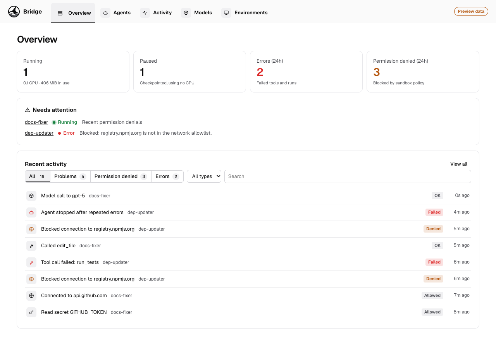

## See it in action

| Flow | Demo |
|---|---|
| Live overview and recent activity: filter problems, drill into an event, jump to the agent | [Watch](#see-every-agent-at-a-glance) |
| Create an agent: purpose, model, repos and MCP servers, security, limits, tests, review, start | [Watch](#create-an-agent-with-a-guided-walkthrough) |
| Inspect an agent: resources, properties, activity, files and settings | [Watch](#agent-details-resources-task-and-properties) |
| Fix a blocked agent with one click and restart it | [Watch](#errors-and-permission-problems-with-one-click-fixes) |
| Shell into a running agent | [Watch](#integrated-shell) |
| Pause, resume, start, copy, delete and stop | [Watch](#pause-resume-stop-copy-and-delete) |
| Add model providers and change the default | [Watch](#choose-models-from-any-provider) |

## Contents

- [Key capabilities](#key-capabilities)
  - [See every agent at a glance](#see-every-agent-at-a-glance)
  - [Create an agent with a guided walkthrough](#create-an-agent-with-a-guided-walkthrough)
  - [Security: decide exactly what an agent can touch](#security-decide-exactly-what-an-agent-can-touch)
  - [Resource limits](#resource-limits)
  - [Agent details: resources, task and properties](#agent-details-resources-task-and-properties)
  - [Errors and permission problems, with one-click fixes](#errors-and-permission-problems-with-one-click-fixes)
  - [Audit log](#audit-log)
  - [Integrated shell](#integrated-shell)
  - [Pause, resume, stop, copy and delete](#pause-resume-stop-copy-and-delete)
  - [Choose models from any provider](#choose-models-from-any-provider)
  - [Agents are plain files in kmx format](#agents-are-plain-files-in-kmx-format)
  - [Environments](#environments)
  - [Light and dark mode](#light-and-dark-mode)
- [Run it](#run-it)
- [How it is built](#how-it-is-built)
- [What is real today](#what-is-real-today)
- [What's next](#whats-next)

## Key capabilities

### See every agent at a glance

**Overview** answers "what is running and is anything wrong?" It shows running and
paused agents with their combined CPU and memory, errors and permission denials in the
last 24 hours, a **Needs attention** list, and the latest activity. Usage and activity
update live.

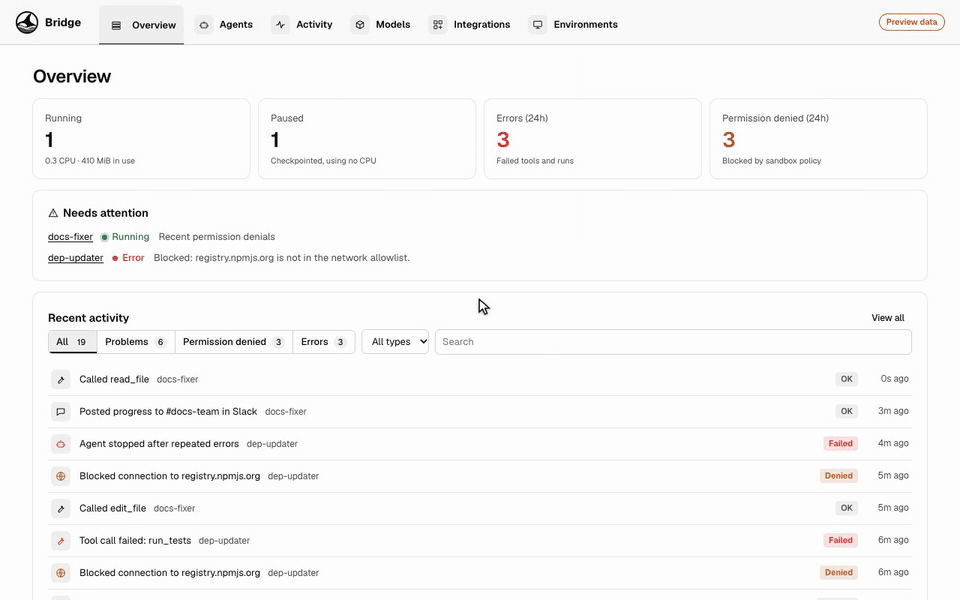

**Agents** lists every agent with its status, network policy, live CPU and memory
against its limits, and **tokens used against its token budget**. Pause, resume, start,
stop, copy and delete are one click away (see the
[lifecycle demo](#pause-resume-stop-copy-and-delete)).

Token counts come from the model gateway: every model request from a sandbox goes
through it, and model APIs report prompt and completion tokens on each response, so
usage is attributed to the agent that made the call. Streaming requests get usage by
having the gateway ask for it (`stream_options.include_usage` on OpenAI-compatible
APIs); local servers such as Ollama and vLLM report counts too. The network allowlist
keeps agents from calling model APIs directly and bypassing the count. In the preview,
token use is simulated.

### Create an agent with a guided walkthrough

**Create agent** walks you through the questions an agent developer should answer, in
seven steps. You can jump between steps; problems are flagged on the step that has them
and must be fixed before saving.

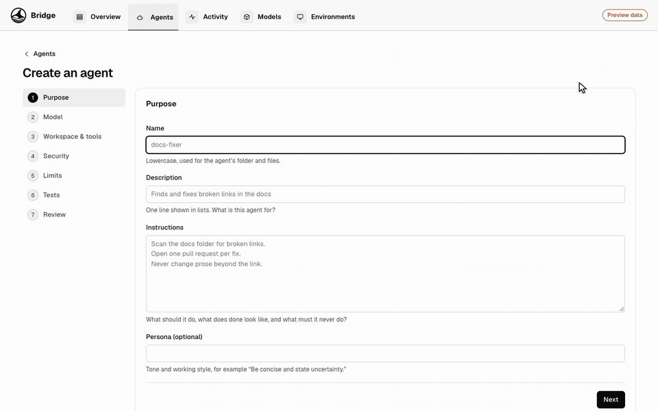

| Step | What it asks |
|---|---|
| **Purpose** | Name, one-line description, instructions (what to do, what "done" looks like, what it must never do) and an optional persona |
| **Model** | Which configured provider and model to use, or add a new provider inline |
| **Workspace & tools** | Git repositories to clone (read-only or read-and-push), MCP servers (remote or local command), skill packages, and which built-in tools the model is offered |
| **Security** | Network, files, credentials and approvals (see below) |
| **Limits** | CPU, memory, disk, maximum run time and token budget |
| **Tests** | Real tasks with a pass condition, saved in kmx's test format |
| **Review** | The exact files that will be saved, plus an optional first task. Create, or create and start |

### Security: decide exactly what an agent can touch

Isolation is **always on** and cannot be turned off: each agent gets its own sandbox,
separate from your computer and from other agents. On top of that you decide:

- **Network:** no network, allowed domains only (recommended, supports `*.example.com`),
  or open internet. Domains used by your repositories and MCP servers are suggested.
  Everything else is blocked and logged.
- **Files:** workspace read-write or read-only. Host folders are invisible unless you
  explicitly share them, each read-only or read-write.
- **Credentials:** grant secrets by name, for example `GITHUB_TOKEN`. Values stay in
  your system keychain and are injected as environment variables. Model access never
  needs one; the model gateway handles it.
- **Ask me first:** pause for your approval before a `git push` or before reaching a
  domain that is not allowed.

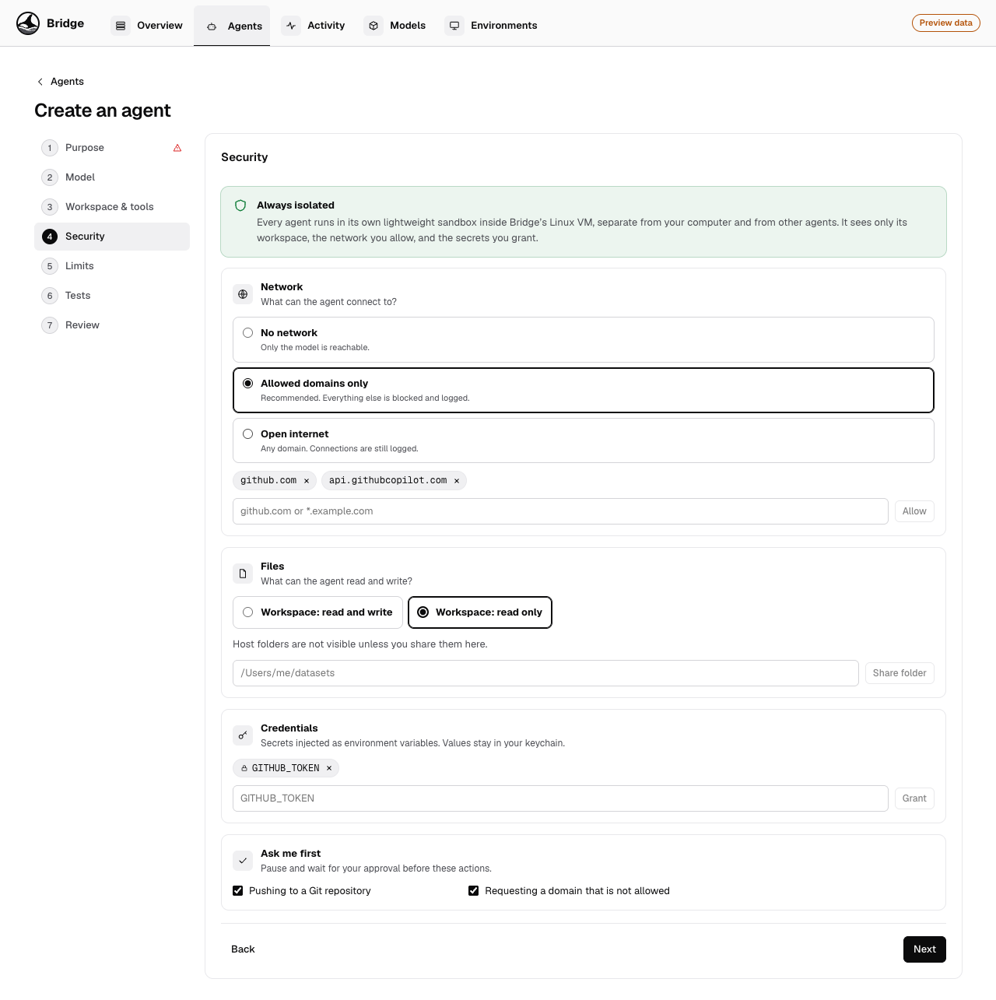

### Resource limits

Limits are enforced by the sandbox, not requested. Defaults suit most coding agents on
a laptop (1 CPU, 1 GiB memory, 5 GiB disk, 2 hours, 500k tokens). When an agent hits its
token budget it is paused; when it hits its maximum run time it is stopped. Both are
recorded in the audit log.

### Agent details: resources, task and properties

Click an agent to see:

- **Current task**, how long it has been running, and a box to give it a new task
- **Resources:** live CPU and memory charts against their limits, token budget, disk and
  network transferred
- **Properties:** model and provider, isolation and limits, network policy, file access,
  credentials, approvals, repositories, MCP servers, skills, tools, tests and creation time

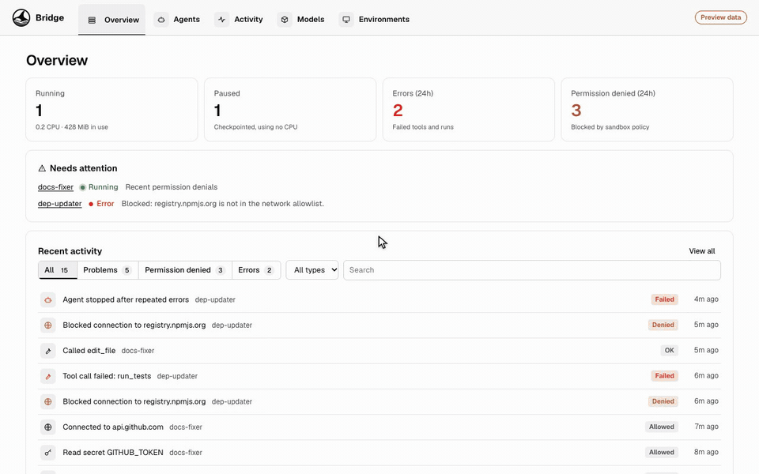

### Errors and permission problems, with one-click fixes

When an agent fails or is blocked, it shows up under **Needs attention** on the Overview,
its status changes, and its page explains why. If it was blocked from a domain, you can
allow that domain with one click, or leave it blocked. Problems are counted on the
**Activity** tab.

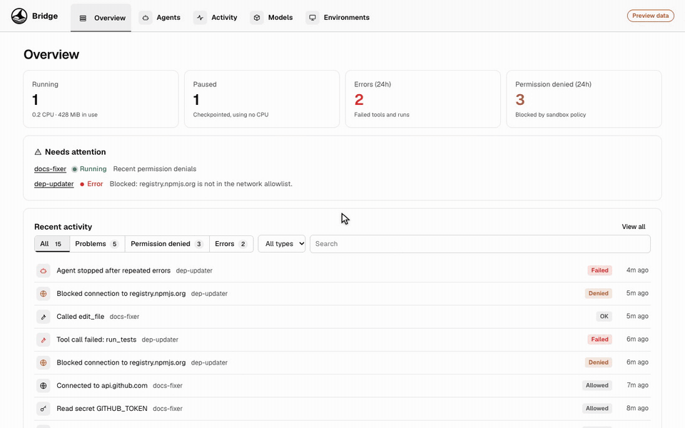

### Audit log

**Activity** is an audit log of everything agents did: lifecycle changes, model calls,
tool calls, network connections, file changes, shell commands and secret use. Filter by
**Problems**, **Permission denied** or **Errors**, by event type, or search. Expand an
event for its details. History is kept after an agent is deleted.

Each agent also has its own Activity tab. The [overview demo](#see-every-agent-at-a-glance)
shows filtering, expanding an event and jumping to the agent.

### Integrated shell

Open a shell inside a running agent's sandbox to see what it is doing. The shell sees
exactly what the agent sees, and its rules apply to you too: a `curl` to a domain outside
the allowlist is refused, a `git push` waits for approval, and secrets are masked. Every
command is recorded in the audit log. Command history works with the arrow keys.

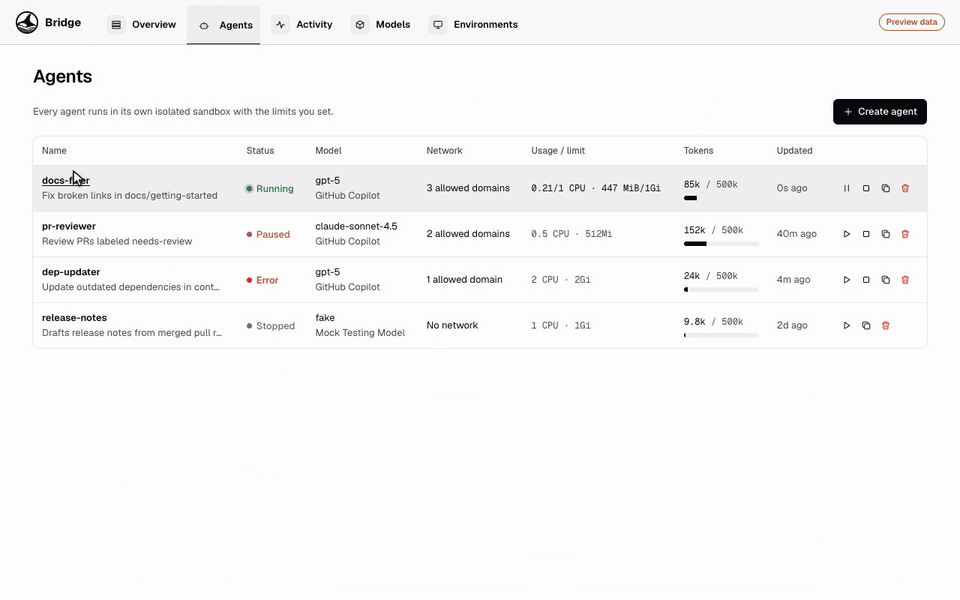

> In the preview, the shell is simulated and supports `ls`, `cd`, `pwd`, `cat`, `env`,
> `ps`, `top`, `df`, `curl`/`wget`, `git status|log|push`, `echo`, `clear` and `exit`.

### Pause, resume, stop, copy and delete

| Action | What happens |
|---|---|
| **Pause** | Checkpoints the sandbox; uses no CPU while paused |
| **Resume** | Continues where it left off |
| **Stop** | Removes the sandbox and keeps the workspace |
| **Start** | Starts again, optionally with a new task |
| **Copy** | Duplicates the agent's definition under a new name (`name-copy`) |
| **Delete** | Asks for confirmation, removes the sandbox and workspace, keeps the audit history |
| **Edit** | Reopens the guided walkthrough with the current settings |

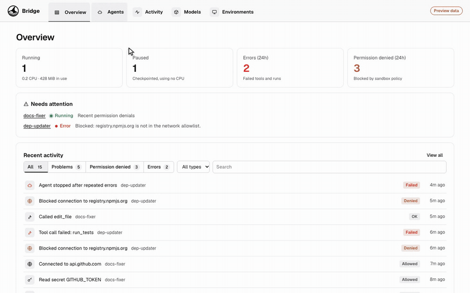

### Choose models from any provider

**Models** holds the providers agents can use, shared across agents. Pick a provider,
fill in only the fields it needs, and list the models agents may choose. One provider is
the default for new agents.

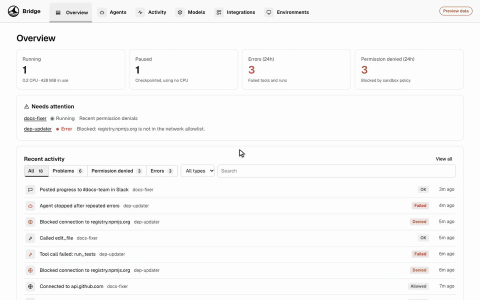

Supported: GitHub Copilot (uses your existing sign-in, no key), OpenAI, Azure OpenAI,
Anthropic, Mistral AI, Google Gemini, DeepSeek, vLLM or any OpenAI-compatible endpoint,
local models such as Ollama or LM Studio, and a mock model for testing.

API keys go to the system keychain. Agents never see them; the model gateway adds them
to requests.

### Agents are plain files in kmx format

Each agent is saved as a folder of plain text files in
[kmx](https://github.com/kaimahi-agents/kaimahi)'s agent file format, so it can be
reviewed, committed to Git, and read by kmx:

```text
issue-triage/
├── issue-triage.agent.md        # frontmatter + instructions (the prompt)
├── issue-triage.agent.test.md   # tests, one `yaml agent-test` block each
└── kmx.yaml                     # local MCP servers (only when there are any)
```

```markdown
---
name: issue-triage
description: Labels and routes new GitHub issues
model: gpt-5
kmx:
  schemaVersion: 1
  runtime: orka
  soul:
    inline: Be concise and state uncertainty.
  skills:
    - name: triage-rules
  tools:
    - name: read_file
    - name: search_code
bridge:
  schemaVersion: 1
  modelProvider: github-copilot
  workspace:
    git:
      - repo: https://github.com/contoso/api.git
        branch: main
        access: read-only
    mcp:
      - name: github
        url: https://api.githubcopilot.com/mcp/
        tools: [add_issue_labels, add_issue_comment]
    skills:
      - name: triage-rules
        source: github.com/contoso/skills/triage-rules
  security:
    isolation: sandbox
    network:
      default: deny
      allow: [github.com, api.githubcopilot.com]
    filesystem:
      workspace: read-only
      host: []
    secrets: [GITHUB_TOKEN]
    approvals:
      gitPush: true
      newDomains: true
  limits:
    cpu: 0.5
    memory: 512Mi
    disk: 5Gi
    maxRuntime: 2h
    maxTokens: 500000
---
Read each new issue in contoso/api.
Add one area label and one priority label.
Ask for reproduction steps when they are missing.
Never close issues.
```

- Fields kmx understands use kmx's native schema: `name`, `description`, `model` and the
  `kmx:` block. Tools use Orka's `{name}` tool reference shape under `kmx.tools`.
- Settings kmx does not model yet (workspace, security, limits) live under `bridge:`.
  kmx keeps them and reports them as unrepresented rather than dropping them.
- The generated files are checked against kmx's own native file reader.

You can see an agent's files on its **Files** tab and on the last step of the walkthrough
(both appear in the demos above).

### Environments

**Environments** shows where agents run: this machine (a lightweight Linux VM managed by
Bridge, with a sandbox per agent) and, later, shared team environments you can send an
agent to. It also reports whether the agent engine is available.

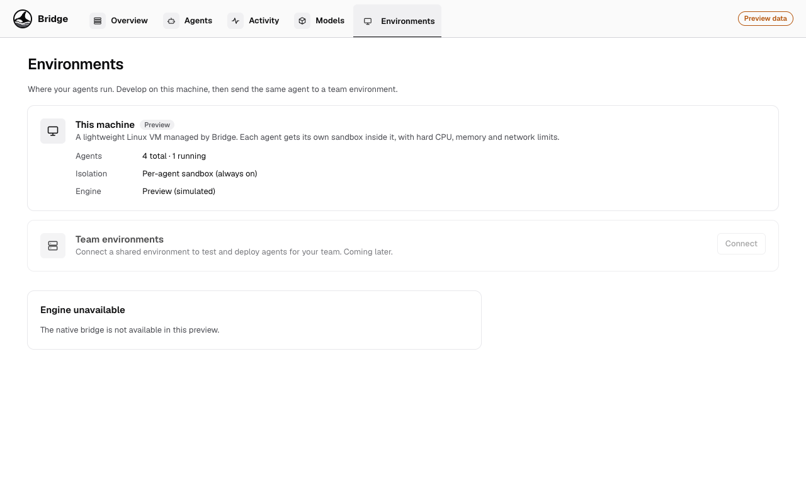

### Light and dark mode

The UI follows your system appearance.

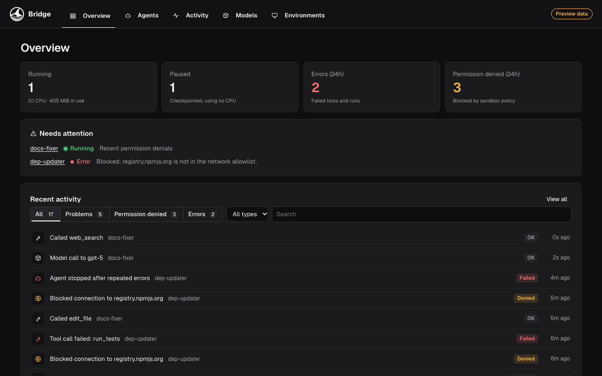

## Run it

From this folder (`app/`), with Node 26.5 or newer:

```sh
npm ci
npx vite --host 127.0.0.1
```

Then open <http://127.0.0.1:1420>. The preview starts with four example agents: one
running, one paused, one blocked by its network policy, and one stopped. Your changes are
kept in the browser's local storage; clear site data to start over.

To run the desktop app instead, see the [main README](../README.md#development).

Checks:

```sh
npm run lint   # ESLint and TypeScript
npm test       # Vitest
npm run build
```

## How it is built

```text
React UI ──► AgentEngine interface ──► PreviewEngine (today, simulated)
                                   └─► kmx / AX runtime (planned)
```

| Path | What it holds |
|---|---|
| [`src/App.tsx`](src/App.tsx) | Shell, navigation and routing between pages, the walkthrough and agent details |
| [`src/agents/types.ts`](src/agents/types.ts) | Agent, audit event and model provider types |
| [`src/agents/engine.ts`](src/agents/engine.ts) | `AgentEngine`: the only boundary between the UI and whatever runs agents, including which features an engine supports |
| [`src/agents/previewEngine.ts`](src/agents/previewEngine.ts) | Simulated engine: lifecycle, usage, audit events, local persistence |
| [`src/agents/spec.ts`](src/agents/spec.ts) | Validation and kmx file generation |
| [`src/agents/policy.ts`](src/agents/policy.ts) | Network allowlist matching |
| [`src/agents/shell.ts`](src/agents/shell.ts) | Simulated sandbox filesystem and shell |
| [`src/agents/providers.ts`](src/agents/providers.ts) | Model provider catalog |
| [`src/components/`](src/components) | Walkthrough, agent details, shell, activity list, provider picker |
| [`src/pages/`](src/pages) | Overview, Agents, Activity, Models and Environments pages |

A real engine implements `AgentEngine` and translates each agent's files into its own
runtime objects, for example an AX Task, Workspace and Model, or an Orka Agent through
kmx. Each engine reports which features it supports so the UI can disable controls it
cannot enforce instead of faking them (Pause uses this today).

The UI never mentions Kubernetes terms such as clusters, pods or namespaces, even when
an engine uses Kubernetes underneath. A test enforces this.

## What is real today

| | Status |
|---|---|
| Screens, navigation, walkthrough, validation | Working |
| kmx file generation | Working, checked against kmx's native reader |
| Agent lifecycle, usage, audit log, shell | **Simulated** by the preview engine |
| Sandbox isolation and limit enforcement | **Not implemented**; needs a real engine |
| Saving agent files to disk or Git | **Not implemented**; files are shown, kept in browser storage |
| Keychain storage for API keys | **Not implemented**; the preview discards keys and keeps only a reference |
| Approvals for `git push` and new domains | Shown in policy and shell; approval flow **not implemented** |
| Team environments | **Not implemented** |

## What's next

- Connect a real engine: kmx for local Orka, and AX for sandboxed tasks with
  suspend/resume and shell access
- Save agents as files on disk or in a Git repository
- Approval inbox for held actions
- Run an agent's tests from the UI and show pass/fail
- Send an agent to a team environment
- VS Code integration
